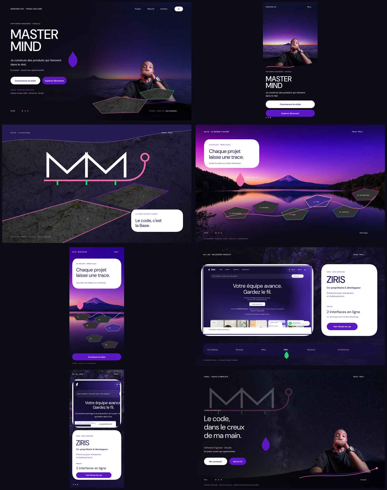

# 11 — Moodframes Candidate 3.2

## 1. Verdict de direction

Les huit preuves visuelles C3 existent en SVG éditable et en PNG de revue. Elles remplacent Candidate 2, rejetée par Russel pour ses couleurs mortes, son excès de clair et son monde visuel devenu incompatible avec la décision Japon.

Candidate 3.2 applique désormais :

- sombre violet vivant majoritaire, blanc franc minoritaire et accents naturels ;
- Japon comme horizon artistique, jamais comme origine de Russel ;
- portrait détouré intégré à l'univers, visage inchangé ;
- décors Magnific déclarés comme images générées ;
- vraie interface ZIRIS, jamais reconstruite ;
- panneaux sans bornes latérales ni séparateurs horizontaux décoratifs récurrents ;
- silhouettes organiques alternées ; fleur-goutte utilisée pour les repères visuels dans leur couleur correspondante et retirée du chrome « HORIZON 237 » ;
- rose sakura `#f06aa6` à la place de l'ancien accent brun ;
- pierres, Soleil, planètes et comète spécifiés comme objets 3D futurs, jamais comme images plates.

Russel valide la base de direction C3 le **20 octobre 2026**, avec un amendement typographique obligatoire : employer DM Sans, la famille réellement utilisée par ZIRIS Entreprises, et ne créer aucune police. Le **21 octobre 2026**, il demande la correction organique C3.1, puis précise en C3.2 que les points décoratifs doivent reprendre la fleur-goutte correspondante, sans fleur au niveau du libellé récurrent « HORIZON 237 ». Les huit SVG, leurs PNG et la planche de contact ont été réémis avec ces corrections. Russel valide la version finale C3.2 le même jour. Le statut est **C3.2 VALIDÉE PAR RUSSEL**.

## 2. Registre des huit vues

| ID | Fichier | Viewport | Ce que la vue prouve | Sources visibles |
|---|---|---:|---|---|
| `MF-C3-01` | `MF-01-ACCUEIL-DESKTOP` | 1440 × 900 | identité immédiate, portrait intégré, deux entrées et sombre vivant | aube C3, portrait détouré, basalte C3 |
| `MF-C3-02` | `MF-02-ACCUEIL-MOBILE` | 390 × 844 | même promesse sans texte sur le visage, actions pleine largeur | aube C3, portrait détouré |
| `MF-C3-03` | `MF-03-RACCORD-3S` | 1440 × 900 | monogramme transformé en chemin minéral, sans main ni vidéo fictive | basalte C3, monogramme vectoriel |
| `MF-C3-04` | `MF-04-REVELATION-DESKTOP` | 1440 × 900 | révélation du lac, six stations équitables et intention de vraie 3D | lac C3, géométries de direction |
| `MF-C3-05` | `MF-05-REVELATION-MOBILE` | 390 × 844 | parcours vertical recomposé, choix immédiat et même parité | lac C3, géométries de direction |
| `MF-C3-06` | `MF-06-BELVEDERE-ZIRIS-DESKTOP` | 1440 × 900 | produit réel dominant, rôle, attribution et preuve courte | glycines C3, capture ZIRIS réelle |
| `MF-C3-07` | `MF-07-BELVEDERE-ZIRIS-MOBILE` | 390 × 844 | média puis rôle puis preuve, sans miniature ni mur de texte | glycines C3, capture ZIRIS réelle |
| `MF-C3-08` | `MF-08-FINAL-MONOGRAMME-PORTRAIT` | 1440 × 900 | final humain, phrase de Russel, contact et trace complète | univers étoilé C3, portrait détouré, monogramme |

Chaque base de nom possède un `.svg` et un `.png` dans `moodframes-c3/`. Les PNG sont rendus mécaniquement depuis les SVG ; aucun nouvel élément d'image n'est généré pendant ce rendu.

## 3. Ce qui rend C3 différente

### Le décor n'avale pas l'humain

L'aube, le lac, les glycines et les étoiles donnent de la profondeur, mais l'identité, le produit réel et les preuves gardent les zones les plus lisibles. Le portrait n'est ni enfermé dans une carte, ni recouvert de copy.

### Le sombre reste vivant

Le noir violet `#0e0b17` n'apparaît jamais comme un vide uniforme : photographie, basalte, étoiles ou profondeur violette restent perceptibles. Le blanc découpe une décision ou une preuve ; il ne remplit pas l'écran.

### La couleur a une fonction

- violet : identité, structure et actions ;
- vert : progression, nature et focus sombre ;
- rose sakura : trace, raccord et chaleur douce ;
- magenta/bleu/corail : ponctuations rares ;
- blanc : choix et preuve.

Aucun accent ne devient un halo, un tube néon ou un gradient SaaS autonome.

### Le produit reprend le pouvoir

Au belvédère, la capture ZIRIS réelle occupe la majeure partie de la surface utile. Le décor de glycines devient périphérique. La copy reste humaine : nom, rôle, usage, preuve et action — rien de plus.

## 4. Contrat de vraie 3D

Les polygones visibles dans `MF-C3-01`, `MF-C3-03`, `MF-C3-04` et `MF-C3-05` sont des annotations de volume, pas des actifs à intégrer. Claude doit les remplacer par :

- géométries Three.js/R3F éclairées dans la scène ;
- matériau basaltique PBR/procédural ;
- ombres cohérentes avec l'aube ;
- profondeur et parallaxe mesurées ;
- version statique accessible sans WebGL.

Le Soleil montré dans la révélation devient lui aussi un objet 3D. Les planètes restent secondaires aux preuves. La comète n'apparaît pas dans ces huit vues ; lorsqu'elle sera conçue, elle suivra le snapshot GitHub statique prévu par le contrat.

## 5. Sources et honnêteté

- décors : masters 4× de `assets/c3-upscaled/`, provenance et conditions dans `09_SOURCE_KIT_REEL.md` ;
- portrait : `design/magnific__background__71841.png`, détourage déclaré, identité inchangée ;
- ZIRIS : captures publiques réelles de `assets/source-derivatives/` ;
- monogramme : `assets/trace-237-monogram.svg`, création vectorielle originale ;
- police unique : DM Sans officielle, famille de ZIRIS Entreprises, SIL OFL 1.1 ; monospace système réservé au code.

Les décors Magnific restent `RIGHTS_PENDING` jusqu'à archivage des conditions applicables au compte utilisé. Leur présence dans une maquette ne vaut pas autorisation de publication.

## 6. Visa visuel de Russel

> « Je valide la direction visuelle C3 » — Russel, 20 octobre 2026.

Ce visa couvre la base C3 et son amendement typographique : utiliser la police de ZIRIS Entreprises, sans inventer ni créer de police. Vérification de Codex sur la page publique et ses CSS : la famille appliquée est `DM Sans`, titres compris. Les corrections C3.1 et C3.2 demandées le 21 octobre — formes organiques, retrait des bornes et lignes répétées, fleur-goutte aux repères et absente du chrome récurrent — ont reçu le visa de couverture de Russel le même jour.

> « Je valide. » — Russel, 21 octobre 2026, après présentation de la correction finale C3.2.

Ce second visa couvre la correction C3.2, les 65 vues et les deux planches de parité ; `DR1-R13` est fermé côté design.

Russel confirme également que l'absence de la comète dans ces huit moodframes est normale et valide ce périmètre. Cette validation ne retire pas la fonctionnalité : la comète reste requise dans la future vue `A07 — Compétences / Comète`, avec un snapshot GitHub statique, daté et sans appel API côté navigateur.

## 7. Ce que ces planches ne ferment pas

- la réémission ultérieure des empreintes par Claude, sans modification de son manifeste ni de son registre dans ce lot ;
- les mesures de luminance, poids, mémoire, contraste et appareils ;
- le son, sa licence et l'ADR du lecteur officiel.

Candidate 3.2 ferme les corrections de forme demandées le 21 octobre et possède désormais le visa perceptuel de Russel. Elle ne transforme aucune réserve factuelle, juridique ou technique en `PASS`.
