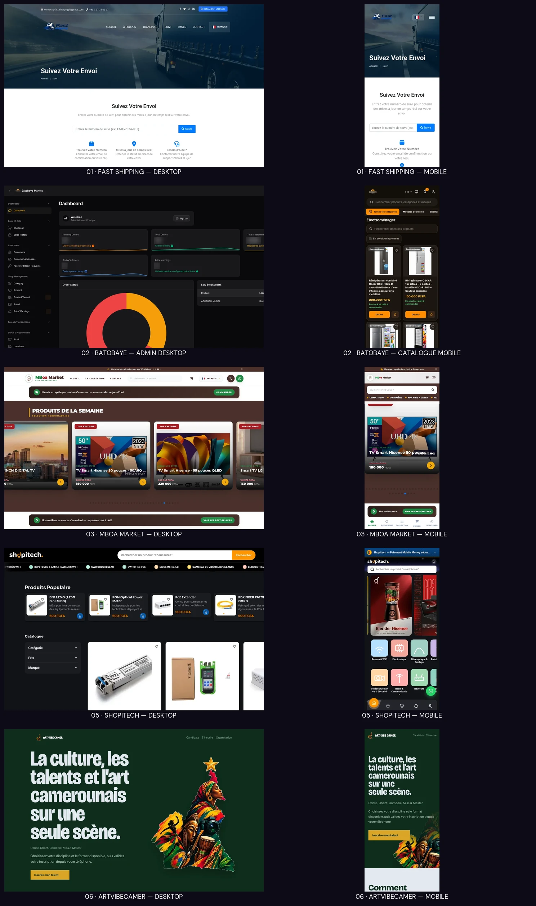

# 12 — Médias des cinq projets C3

## 1. Verdict

Les cinq projets qui ne disposaient pas encore d'un média C3 possèdent désormais chacun une paire de référence **desktop 1440 × 900** et **mobile 390 × 844**. Les dix dérivés proviennent exclusivement des captures réelles fournies dans `captures-projets/` : aucune interface n'a été générée, reconstruite, retouchée dans son contenu ou placée dans un faux appareil.

**État : `APPROVED BY RUSSEL — DESIGN`.** Russel valide les médias C3 des cinq projets le 20 octobre 2026. Ces fichiers restent des références de Design Release ; Claude doit encore les enregistrer dans le manifeste et le registre avant de produire les dérivés publics d'intégration.

## 2. Sélection principale

| Ordre | Projet | Média desktop | Média mobile | Ce que la paire montre | Droit et limite connus |
|---:|---|---|---|---|---|
| 01 | Fast Shipping logistique | suivi de colis et formulaire | même fonction recomposée sur mobile | fonction métier développée par Russel, sans afficher de colis réel | accord déclaré par Russel ; aucune autorisation nommée de l'agence |
| 02 | Batobaye Market | administration, commandes et stock | catalogue Électroménager public | étendue admin + storefront ; métriques internes déjà masquées dans la source | permission verbale du PDG ; aucune donnée client visible |
| 03 | MBoa Market | produits de la semaine | storefront PWA mobile | catalogue, prix publics et adaptation mobile | permission verbale du PDG de la maison mère |
| 05 | Shopitech | catalogue technique et filtres | navigation par familles de produits | beta publique desktop/mobile, sans prétendre à une application publiée | autorisation Shopitech déclarée ; forme non précisée |
| 06 | ArtVibeCamer | entrée de la plateforme culturelle | même promesse et inscription mobile | identité publique, disciplines et point d'entrée d'inscription | autorisation SAM BIAI déclarée ; aucun candidat ni paiement affiché |

ZIRIS garde la paire déjà approuvée dans `assets/source-derivatives/` et occupe l'ordre 04. Les six projets conservent donc un contrat média équivalent, sans établir de hiérarchie de valeur entre eux.

## 3. Sources, dérivés et intégrité

| ID | Source PNG · SHA-256 | Dérivé WebP · SHA-256 |
|---|---|---|
| `H237-PROJ-FAST-D` | `fastshipping-suivi-desktop.png` · `38b804c0018f77308baa801a2600bc116a41d9d8b5ce230aaea706b3d788accc` | `fast-shipping-tracking-desktop-1440.webp` · `8157d1b2a15cca34f47be4c7c327b750b3a19854cb87123fc311160f44b0c57c` |
| `H237-PROJ-FAST-M` | `fastshipping-suivi-mobile.png` · `285b29de9d6835d965c7bcac85c8eb46b5d5a102dd130d19bac01d53cd73f8f4` | `fast-shipping-tracking-mobile-390.webp` · `d15af61d3d6f8af8a6d38c341a1c136d1bb38d9e63c67deb1cf63cf36700476b` |
| `H237-PROJ-BATO-D` | `batobaye-admin-desktop.png` · `2cdd5ea71d183182049a90d7df535a9d589a5198bcc44b5bbaf1d4c870349540` | `batobaye-admin-desktop-1440.webp` · `da9c85b168688538860e44faa7070040206c6dfd8df253aedfb2ed8cac2a4f19` |
| `H237-PROJ-BATO-M` | `batobaye-categorie-mobile.png` · `64ecaf2e297ac73e6e8f7cd92e63a9e747e3f16d0ab6f8a682af7c19a0171b6d` | `batobaye-category-mobile-390.webp` · `ee9b400d53e34e43291935d8d59595786b4837fca3e22d0324132cc3d79d943b` |
| `H237-PROJ-MBOA-D` | `mboamarkets-semaine-desktop.png` · `207b18bfa82c85bd32245df8477a2678dd5bb0cdace39d73d8686467f1df6197` | `mboa-market-desktop-1440.webp` · `9b840a897c0c51d7a9279cddfc8c6200149bedbae2eceaf88df7df572c32d5ae` |
| `H237-PROJ-MBOA-M` | `mboamarkets-accueil-mobile.png` · `b39c2e17236658adf8576d22c31f0669a8bd22d4ce95a0af4a71ca2c23409e71` | `mboa-market-mobile-390.webp` · `bbbbef2895bafa6a933d8eb0446566faa8633d9362cfe909481d89db3f46091f` |
| `H237-PROJ-SHOP-D` | `shopitech-accueil-desktop.png` · `e84ccd7ce05d368e44d19eec5c2690528773d2b482cef5b1b56086d3697d8203` | `shopitech-desktop-1440.webp` · `a806f2596d60ac857f0b2f2e487aefe245507cde5dd4189b7f29eabd2e49b864` |
| `H237-PROJ-SHOP-M` | `shopitech-accueil-mobile.png` · `c8be53faea5f84bf8be1db85984961a4fb15277e2b3da51f82defff92a26cfa2` | `shopitech-mobile-390.webp` · `94c191bf4866cf52ecbdbe673cfb1346eaac1bf41f3fd55e8fa2403c9e42113b` |
| `H237-PROJ-ART-D` | `artvibecamer-accueil-desktop.png` · `707a2ab22c57b8633d1cdbfe3f9f0c41e36a7907375d83b5f44860d90288c673` | `artvibecamer-desktop-1440.webp` · `3be08ca3d3c26da0bcbcd30d2711f16ef201e9cc91692ab2866975743d777bc9` |
| `H237-PROJ-ART-M` | `artvibecamer-accueil-mobile.png` · `f3020401c7e04d5b45cc6492b5fc0749bc5886e3df56961ccba9d6e612c88580` | `artvibecamer-mobile-390.webp` · `a29808b758b6e2a6e7e41c42b6edcb1713bd71b065ca9095b0809e0b722ed8f8` |

La planche `CONTACT-SHEET-PROJETS-C3.webp` a pour SHA-256 `431e2a862ac8fa8a9aaedefd3fac3da4690cb36e142580c69caf31591aa03400`.

## 4. Transformations déclarées

Toutes les paires suivent le même pipeline mécanique : orientation normalisée, profils et métadonnées retirés, conversion sRGB, redimensionnement Lanczos, recadrage de couverture sans déformation, puis WebP qualité 84. Aucun texte, prix, produit, logo, métrique ou résultat n'a été ajouté ou modifié.

- desktop : cadrage central, sauf Batobaye et Shopitech ancrés à gauche pour conserver navigation et marque ;
- mobile : cadrage central au viewport 390 × 844 ;
- poids observés : 20 à 80 Ko par fichier de revue ;
- couleurs produit préservées : aucun filtre violet, glow, faux reflet ou harmonisation forcée.

## 5. Textes alternatifs de référence

| Projet | Desktop | Mobile |
|---|---|---|
| Fast Shipping | « Page de suivi Fast Shipping avec camion en couverture, champ de numéro de colis et explication des mises à jour. » | « Version mobile du suivi Fast Shipping avec champ de numéro de colis et accès aux étapes d'assistance. » |
| Batobaye Market | « Tableau de bord sombre de l'administration Batobaye Market montrant commandes, alertes de stock et indicateurs masqués. » | « Catalogue mobile Batobaye Market ouvert sur la catégorie Électroménager avec produits, prix et disponibilité. » |
| MBoa Market | « Storefront MBoa Market présentant les produits de la semaine, leurs prix publics et l'action de commande. » | « Version mobile MBoa Market avec recherche, navigation par catégories, produit vedette et accès WhatsApp. » |
| Shopitech | « Catalogue desktop Shopitech consacré aux équipements réseau, avec produits populaires, filtres et grille de produits. » | « Accueil mobile Shopitech avec recherche, produit vedette et grille colorée des familles techniques. » |
| ArtVibeCamer | « Accueil ArtVibeCamer présentant la scène des talents camerounais, les disciplines et l'action d'inscription. » | « Accueil mobile ArtVibeCamer avec la promesse culturelle, les disciplines et le bouton d'inscription d'un talent. » |

Le texte alternatif final doit décrire le média dans son contexte. Il ne doit pas répéter le nom du projet déjà annoncé par le titre du belvédère.

## 6. Sources non retenues comme média principal

- `fastshipping-accueil-mobile.png` : écarté parce que l'accueil contient encore des éléments génériques du thème acheté ; le suivi de colis est une preuve plus juste du travail déclaré de Russel ;
- captures Batobaye de l'application, du produit et de Google Play : conservées comme preuves secondaires possibles pour l'étude de cas, mais non utilisées dans le belvédère principal ;
- `artvibecamer-candidats-mobile.png` : conservé pour l'étude de cas ; l'état vide ne remplace pas l'entrée principale du produit.

Aucune source écartée n'est supprimée. Son absence de la sélection principale ne constitue pas un jugement sur le produit.

## 7. Contrat d'intégration futur

- un seul média actif par belvédère ; aucune galerie automatique en concurrence avec la preuve ;
- capture présentée à plat, sans mockup d'appareil obligatoire ;
- média HTML utile avant le Canvas, avec lien vers l'étude de cas et fallback identique sans WebGL ;
- aucun logo extrait de sa capture pour devenir un actif autonome sans droit distinct ;
- les limites de droits de chaque `CR-0` restent visibles au colophon ;
- Claude produit les dérivés de production AVIF/WebP et les inscrit dans `public/media/approved/**` seulement après le visa visuel de Russel.

## 8. Visa de Russel

Le visa porte sur la sélection et les cadrages des dix médias, pas sur les faits déjà approuvés :

> **« je valide les medias »** — Russel, 20 octobre 2026.

`DR1-R04` est fermé côté design. Les restrictions déclarées dans les `CR-0` restent inchangées : le visa visuel ne transforme pas un accord verbal ou imprécis en autorisation écrite. Le manifeste et le registre restent exclusivement à Claude.
