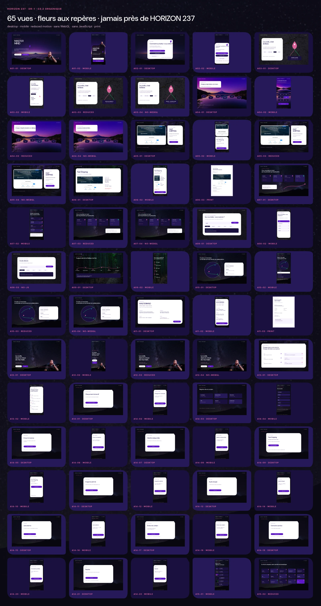
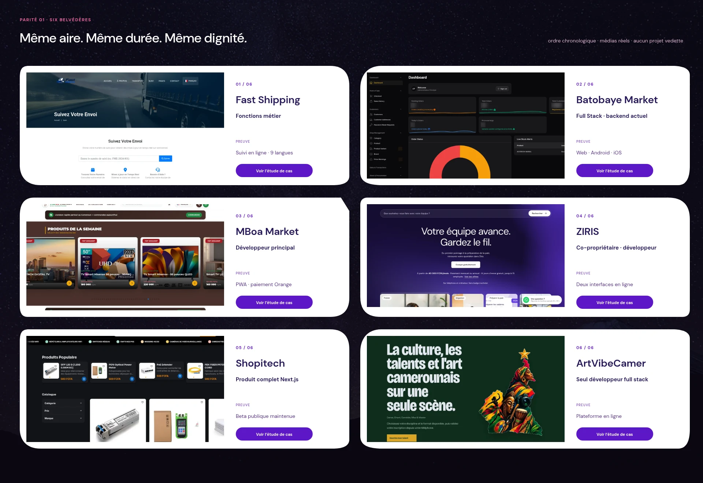
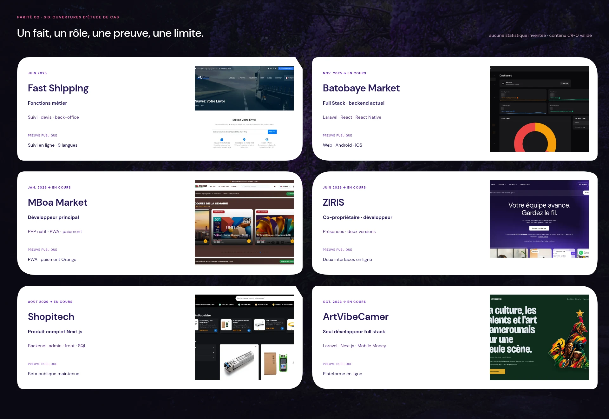

# 13 — Couverture des 65 vues C3.2

## 1. Verdict

La matrice minimale définie dans `03_ECRANS_ETATS.md` est matérialisée par **65 SVG éditables et 65 PNG de contrôle**. Elle couvre desktop, mobile, impression, mouvement réduit, absence de WebGL, absence de JavaScript et onze états système en parité desktop/mobile.

La révision **C3.2 du 21 octobre 2026** applique les corrections de Russel : suppression des bornes latérales et des séparateurs horizontaux décoratifs, alternance de quatre silhouettes de carte, remplacement de l'ancien accent brun par le rose sakura `#f06aa6`, fleur-goutte de la couleur correspondante à la place des points décoratifs et retrait de cette forme du chrome « HORIZON 237 ».

**État : `RUSSEL COVERAGE VISA ACQUIRED — 21 OCTOBRE 2026`.** Les vues démontrent la direction et les comportements attendus ; elles ne constituent ni une intégration fonctionnelle, ni du code applicatif, ni une preuve que les tests G2 à G6 sont déjà passés.

## 2. Décompte contractuel

| ID | Famille | Variantes | Nombre | État C3 |
|---|---|---|---:|---|
| `A01` | Accueil | desktop, mobile | 2 | rendues |
| `A02` | Choix sonore | desktop, mobile | 2 | rendues |
| `A03` | SOURCE | desktop, mobile, reduced, no-WebGL | 4 | rendues ; code exact reporté à G5 |
| `A04` | Promenade | desktop, mobile, reduced, no-WebGL | 4 | rendues |
| `A05` | Belvédère neutre | desktop, mobile, reduced, no-WebGL | 4 | rendues avec média réel Fast Shipping |
| `A06` | Étude de cas | desktop, mobile, print | 3 | rendues depuis CR-0 validée |
| `A07` | Compétences / comète | desktop, mobile, reduced, no-WebGL | 4 | rendues ; snapshot exact reporté à G5 |
| `A08` | Console | desktop, mobile, no-JS | 3 | rendues ; grammaire fermée |
| `A09` | Parcours | desktop, mobile | 2 | rendues depuis la chronologie produit validée |
| `A10` | Ground Track | desktop, mobile, reduced, no-WebGL | 4 | rendues avec territoires validés |
| `A11` | Résumé recruteur | desktop, mobile, print | 3 | rendues ; PDF CV final volontairement exclu |
| `A12` | Final | desktop, mobile, reduced, no-WebGL | 4 | rendues |
| `A13` | Sources & fabrication | desktop, mobile | 2 | rendues |
| `A14` | Onze états système | desktop + mobile pour chaque état | 22 | rendues |
| `A15` | Séquences | mobile, reduced | 2 | rendues |
|  | **Total** |  | **65** | **complet** |

Répartition technique : 24 desktop, 25 mobile, 7 reduced motion, 6 no-WebGL, 2 print et 1 no-JS.

L'inventaire machine lisible est `control-views-c3/inventory.json`, SHA-256 `3f54f662b2b7a9a8cb0152f98db4c36c3e3aa9bfc06b0af6dd277bc257478f8e`.

## 3. Deux preuves de parité

### Six belvédères

- même aire média et même panneau de preuve ;
- même CTA et même densité d'information ;
- ordre chronologique, sans projet vedette ;
- captures produit réelles, sans mockup ni recoloration.

SHA-256 : `d3192b8732c735994b37e59274a6c2ef8c1687cd4d06d62996117259746f11f4`.

### Six ouvertures d'étude de cas

Chaque ouverture conserve le même contrat : période, nom, rôle, périmètre court, preuve publique et média. La couleur propre au produit reste un repère, pas une hiérarchie.

SHA-256 : `f2ddb5f608d7e545570617a4845f1ed85beae8d3f1f540ae2d074f341ceef58f`.

## 4. Décisions d'honnêteté

- **SOURCE :** aucune ligne de code synthétique. Les vues montrent le contrat de preuve ; dépôt, chemin, lignes, SHA et licence seront injectés en G5 après contrôle des secrets.
- **Comète :** une seule trace, sans fréquence, score ni faux statut `live`. Sa carte indique que le snapshot daté exact appartient à G5 et que le travail privé n'est pas inclus.
- **Parcours :** seuls les produits et dates déjà validés apparaissent. Les anciens postes Didacsoft, ITEC et freelance restent absents tant que leurs faits ne sont pas corrigés.
- **Ground Track :** Douala est la base ; la France est un territoire client sans ville inventée ; l'Inde décrit la collaboration d'équipe. Le Japon reste un horizon artistique, jamais un lieu de travail attribué à Russel.
- **Résumé recruteur :** les trois vues de contrôle existent, mais aucun PDF CV n'est produit dans ce lot conformément à la décision de Russel de le laisser en attente.
- **États système :** un média absent ne crée aucune boîte vide ; une panne WebGL ne retire aucun fait ; le silence ne bloque jamais la visite.

## 5. Règles visuelles appliquées

- DM Sans unique, avec monospace absent de ces planches faute de code réel à afficher ;
- sombre violet vivant, images texturées et panneaux blancs minoritaires ;
- quatre silhouettes organiques alternées — galet, feuille, coupe douce et arche — sans série de cartes identiques ;
- aucune borne latérale colorée et aucun séparateur horizontal décoratif récurrent ;
- fleur-goutte SVG simple et mate à la place des points décoratifs de repérage ; points ronds réservés à la pagination ou aux données, aucune fleur accolée au libellé récurrent « HORIZON 237 » ;
- rose sakura `#f06aa6` à la place de l'ancien accent brun, employé en trace, repère ou fleur, avec contraste de 6,78:1 sur le canvas ;
- aucune interface inventée, aucun gradient SaaS autonome, aucun glow ou verre généralisé ;
- produit et preuve avant le décor ;
- contrôles de 44 px minimum spécifiés pour l'intégration, panneaux opaques et texte hors des zones mouvantes ;
- variantes reduced motion sans caméra, parallaxe ou information portée par l'animation ;
- variantes sans WebGL avec contenu DOM, médias HTML et actions équivalentes.

## 6. Contrôles exécutés

| Contrôle | Résultat |
|---|---|
| inventaire | 65 entrées uniques |
| SVG | 65 vues + index + 2 planches, tous les XML valides |
| PNG | 65 rendus présents |
| dimensions | desktop/reduced/no-WebGL/no-JS : 1440 × 900 ; mobile : 390 × 844 ; print : 1240 × 1754 |
| poids des PNG de revue | 43,62 Mio au total ; non destinés à la production |
| index | 1600 × 3016, SHA-256 `a4c1321cb2577968b518a6313938ab0b2257d0134e59996fb8905752dfdeeb1f` |
| inspection | accueil, choix sonore mobile, SOURCE, belvédère, compétences/comète, console, parcours, sources, état d'erreur et deux planches de parité contrôlés visuellement |

Claude produira les dérivés de production et les mesures d'intégration dans les gates correspondantes. Le présent lot ne modifie ni `manifest.json` ni `assets/registry.json`.

## 7. Visa acquis

Après présentation de la correction finale C3.2 — fleurs aux repères, aucun symbole accolé à « HORIZON 237 » — Russel répond dans le fil le **21 octobre 2026** :

> **« Je valide. »**

Ce visa couvre les 65 vues C3.2 et les deux planches de parité. `DR1-R13` est fermé côté design. Les faits G5, les tests runtime et le PDF du CV restent des sujets séparés.
